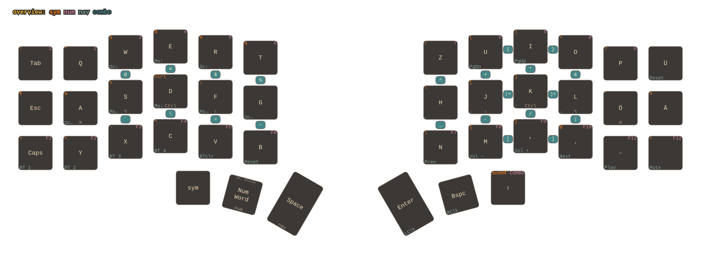
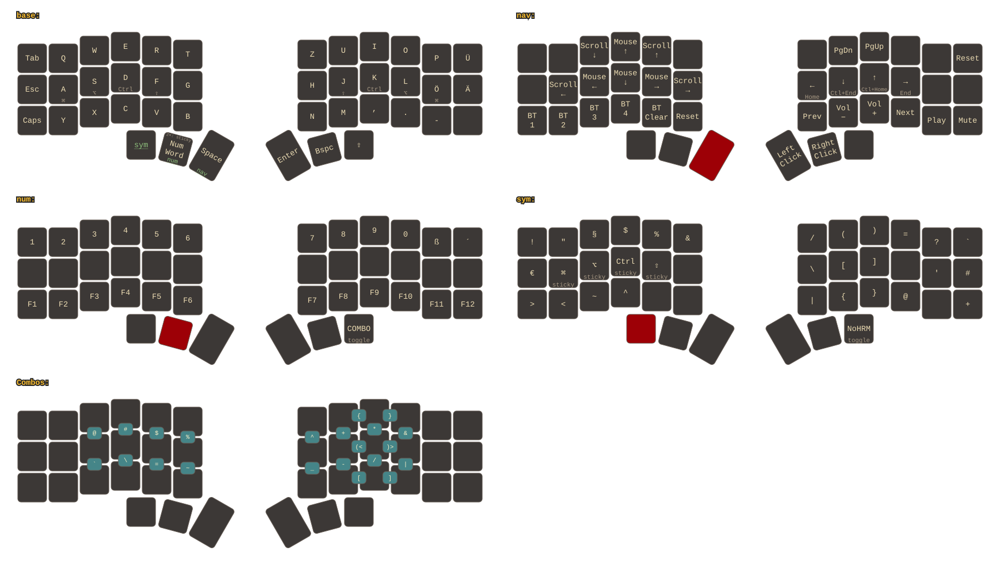

# Corne ZMK config

ZMK config for a 42-key Corne with nice!nano v2 controllers and nice!view
displays.

## Layout

| Path                    | What                                                    |
| ----------------------- | ------------------------------------------------------- |
| `config/corne.keymap`   | Keymap: layers, homerow mods, nav cluster, mouse keys   |
| `config/corne.conf`     | Firmware settings (Bluetooth, sleep, display, USB)      |
| `config/west.yml`       | Pins ZMK to `v0.3`                                      |
| `build.yaml`            | Build matrix: left, right, `settings_reset`             |
| `config/zmk-helpers/`   | Vendored keymap macros (header only)                    |
| `vendor/zmk-auto-layer` | Vendored `num_word` behavior (C module)                 |
| `modules/udo-status`    | udo status on the right nice!view (C module)            |
| `host/udo-keyboard/`    | Mac daemon for udo status (reference copy of dotfiles)  |
| `host/probe.py`         | Raw HID probe from the udo-status bring-up (spike tool) |
| `zephyr/module.yml`     | Registers the local modules as a Zephyr module          |
| `build.sh`              | Local Docker build, same image as CI                    |

Push to GitHub and the Actions workflow builds the firmware. Download the
artifact, double-tap reset on each half and copy the matching `.uf2` file.

## Local build

Needs Docker running. Uses the same image as GitHub Actions.

```sh
./build.sh            # all targets from build.yaml -> firmware/*.uf2
./build.sh left       # only targets matching "left"
./build.sh --update   # after changing config/west.yml
./build.sh --clean    # drop the cached ZMK/Zephyr workspace
```

The first run downloads ZMK + Zephyr (~2 min). After that, a rebuild takes a
few seconds. On failure the error lines are printed and the full log is saved
next to the firmware.

## udo on the right screen

The right nice!view shows what `udo` (time tracker CLI) is timing: `▶ 1:23`
plus the task name, `idle`, or `udo ?` when nothing arrived for 3 minutes
(daemon not running, keyboard on another host). Battery and connection stay
on top.

```
udo_keyboard.py --raw HID--> left half (central_relay.c) --GATT--> right half (screen)
```

The Mac daemon polls `udo status --json` every 10 s, sends on change and every
60 s as a heartbeat; the right half counts the timer itself. The firmware
lives in `modules/udo-status`, the daemon in `host/udo-keyboard`. That folder
is a reference copy: the installed one comes from the dotfiles (`udo` stow
package → `~/.config/udo-keyboard`); `install.sh` works from either place.

**On/off:** `CONFIG_UDO_STATUS` in `config/corne.conf` is the only switch.
With `=n` the left half has no raw HID and the right shows the stock
balloon/mountain screen. Flash both halves after changing it.

```sh
~/.config/udo-keyboard/install.sh               # venv + LaunchAgent, starts at login
~/.config/udo-keyboard/install.sh --uninstall
tail -f /tmp/udo-status.log
modules/udo-status/tests/run.sh                 # firmware unit tests (host cc)
python3 -m unittest host/udo-keyboard/test_udo_keyboard.py   # daemon tests
```

The packet format below is shared by both sides: change `packet.h` and the
daemon (here and in the dotfiles) together; both test the same 32-byte vector.

Packet (32 bytes, little-endian): `[0]=0x55` magic, `[1]=0x01` version, `[2]`
state (0 idle, 1 running), `[3]=0`, `[4..7]` elapsed seconds, `[8..31]` task
name (24 chars, ASCII, NUL-padded; umlauts transliterated). The left half asks
the right half for a larger ATT MTU; if it is not granted it sends the first
20 bytes only (name cut to 12). After flashing a left half
with a new GATT layout, macOS may need the keyboard removed and re-paired.

## Keymap drawing

`./draw.sh` renders `draw/keymap.svg` (and `draw/keymap.png` if
`rsvg-convert` is installed) with
[keymap-drawer](https://github.com/caksoylar/keymap-drawer), in Docker.
Legends show what the German Mac layout types; the mapping lives in
`draw/config.yaml`. Re-run it after changing the keymap.

It also renders `draw/overview.svg`: all layers on one keyboard, with the base
key in the middle and the other layers in the corners (sym ↖ orange, num ↗
purple, nav ↙ blue) and the combos as small boxes between the keys they
need. Both are generated from the keymap, nothing to maintain by
hand; corner assignment and short labels live in `draw/postprocess.py`.

`./draw.sh && ./wallpaper.sh` makes the overview the macOS wallpaper on every
Space and display (and for new Spaces), centered on black and rendered at the
`LG Monitor`'s native resolution. It writes macOS' wallpaper store directly
(backup: `Index.plist.bak` next to it) because AppleScript only reaches the
visible Space. The image lives in `~/Pictures/corne-keymap/`.




## Layers

- `DEF`: QWERTY + homerow mods
- `NAV` (hold Space): arrows, mouse, media keys, Bluetooth profiles, reset
  (one per half: bottom-left inner, top-right corner)
- `NUM` (num key): numbers, F-keys below them
- `SYM` (left thumb outer key): symbols
- `NOHRM` (`SYM` + right thumb outer key, same key alone toggles it off):
  plain keys for gaming

To flash, double-tap the reset button on each half (no bootloader key).

`COMBO` (toggled with `NUM` + right thumb outer key) is `DEF` plus symbol
combos; toggling it off turns the combos off. Combo map is at the top of the
combo section in `config/corne.keymap`. The Mac must use the
German layout; `config/de_mac.h` names what each keycode types there.

## Bluetooth troubleshooting

1. Remove the keyboard in macOS Bluetooth settings.
2. Flash `settings_reset` to both halves, then the normal firmware again.
3. Reset both halves at the same time so they pair with each other.
4. Pair with the Mac again.

Do this whenever HID-related settings change (e.g. mouse keys), since macOS
caches the old device description.

## Credits

Based on [urob's zmk-config](https://github.com/urob/zmk-config).

Vendored code, both MIT licensed (see the `LICENSE` file in each folder):

- [urob/zmk-helpers](https://github.com/urob/zmk-helpers) `v0.3`
  (`b1548efd28d2cc64b9506654e6883695c258190f`): `helper.h`,
  `key-labels/42.h`
- [urob/zmk-auto-layer](https://github.com/urob/zmk-auto-layer) `v0.3`
  (`b31aa0a357343535a56d535edd0c2ad64d3d7230`)

`zmk-helpers` lives in `config/` because ZMK's build only copies `config/` for
keymap includes.
